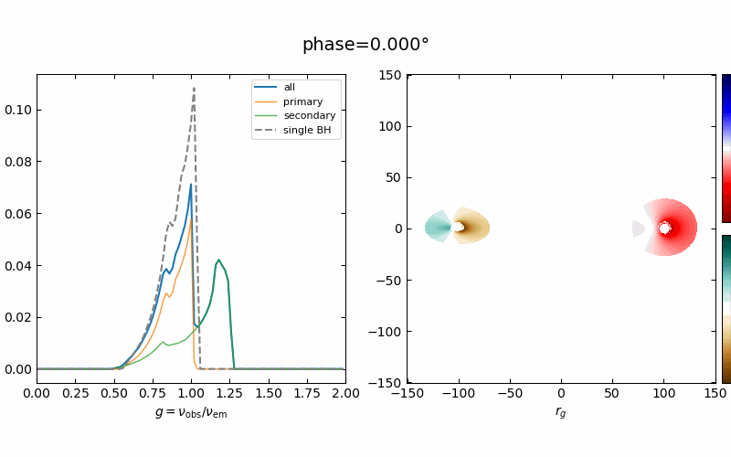

# Self-Lensed-Fe-K-alpha-Line-Profiles-from-Accreting-Disks-in-Binary-Black-Hole-Spacetimes

# Fe Kα Line Profile Evolution in a Supermassive Black Hole Binary

This repository presents the full-orbit evolution of the Fe Kα line profile emitted by two mini-disks around a supermassive black hole binary. The profiles are computed by tracing photons through an approximate binary spacetime. The animation below shows how orbital motion and self-lensing change the total line profile and the separate contributions from the primary and secondary disks. The left panel displays the line profiles; the right panel shows the corresponding images of the two disks. The fiducial model has equal-mass, non-spinning black holes separated by $200\,r_{\rm g}$, with an edge-on binary orbit and disk inclinations of $30^\circ$ and $60^\circ$.

